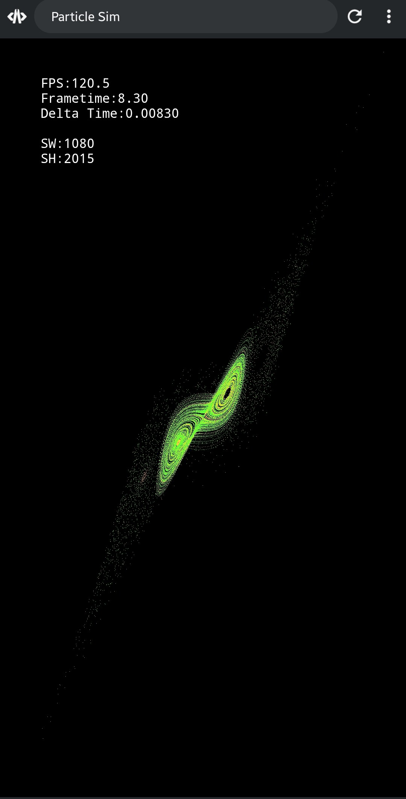
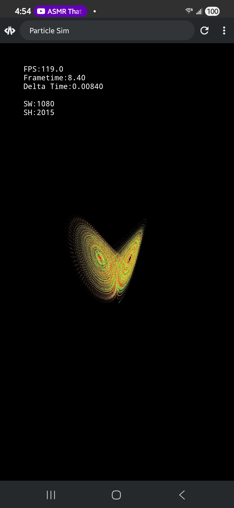
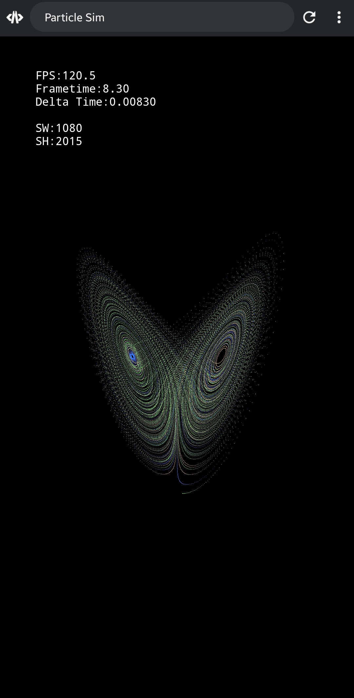

# Canvas Particles

A simple particle playground built with vanilla JavaScript and Canvas 2D.

Originally an experiment to recreate the fireworks screensaver on an LG OLED TV, it has since evolved into a 3D particle simulator featuring interactive fireworks and a *strange* attractor.

## Screenshots

  
  
  

## Videos

### Fireworks Demo

https://github.com/user-attachments/assets/9f754cf0-30b1-42eb-acde-47c7b00ce2cd

### Particle Demo

https://github.com/user-attachments/assets/da80877b-e57a-473f-b2c0-0456bd27c8f6

## Built With

- Vanilla JavaScript
- HTML5 Canvas 2D
- Tweakpane (Planned)
- No frameworks

## License

MIT License
